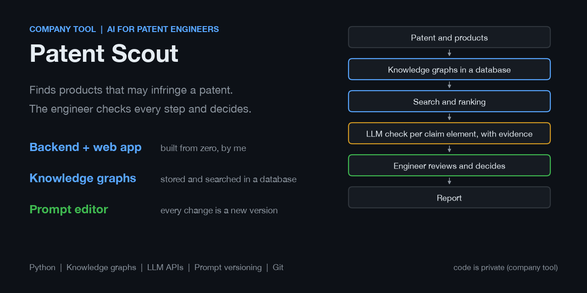
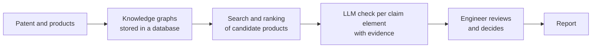

# Patent Scout

An AI tool for the patent engineers at Wilhelm Böllhoff. It automates a large part of the search for products that may infringe a patent, and more use cases are planned. The code is private, so this folder only describes it.

Before, the engineers read the claims, searched for products and compared everything by hand in several tools. Now the engineer enters a patent number and works with the result.

**What I did**
- I built the whole tool from the ground up: the backend and the web front end, in parallel. I started with the work steps of the engineers and learned the patent field first, because I had no background in it.
- I extract knowledge graphs from patent claims and products, store them in a database that I designed and manage, and run the search on that database.
- I set up the Git structure for the team repository and advise the team on how to use Git, so that several people can work on the code without breaking each other's work.
- I work on the prompts as a part of the product: I write, test and improve them, and I built a prompt editor into the tool. Engineers can open a prompt, change it and save it as a new version. Nothing is overwritten, so versions can be compared and a bad change can be undone.
- I change the tool with the engineers' feedback. The engineer always has the last word, and a correction is saved next to the model's answer.
- I tested it like software, with automated tests, an offline end-to-end test and documentation, so others can install and maintain it.

**An earlier tool for the same team, with measured numbers.** Before Patent Scout I built a batch tool that asks an LLM the same question about many patents from the IP7 database in parallel and writes the answers to Excel. I measured it on 25 real patents: 40 seconds with 10 parallel queries and 138 seconds one after another, so the parallel queries alone are 3.5 times faster. A patent engineer estimates at least 30 seconds per patent by hand, which is about 12 minutes for the same 25 patents. That makes the tool about 19 times faster than the manual work. Extrapolated to 500 patents, it is about 15 minutes against at least 4 hours.

**Where I am taking it:** make it ready for long-term use, lower the cost per analysis, increase the precision and correctness of the answers and reduce the manual work of the engineers even more.

The research question behind it is my master's thesis (TU Dortmund with Wilhelm Böllhoff, submission 1 December 2026): AI-Based Patent Infringement Detection Using Knowledge Graphs and Multimodal Language Models.

**Tools:** Python, knowledge graphs, GraphRAG, LLM APIs (GPT, Claude, Gemini), a database, prompt engineering, Git
